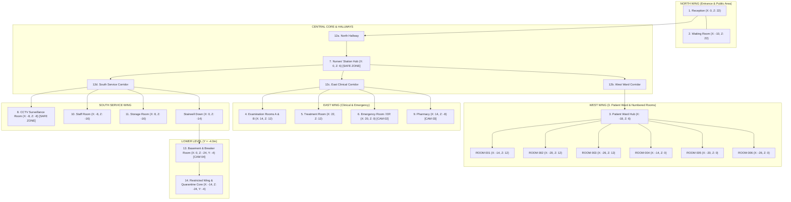

# HOSPITAL SIMULATOR: THE IMPOSTORS — MASTER TECHNICAL & DESIGN SPECIFICATION

> **Document Purpose:** This specification is the authoritative, concrete engineering and gameplay blueprint for transforming the existing prototype (`index.html`) into a complete, single-player 3D hospital horror investigation and survival campaign. Every architectural decision, mechanic, room layout, entity rule, UI interaction, and verification test is explicitly defined here so executing AI agents can implement the game without ambiguity or placeholder shortcuts.

---

## 0. PRIORITY ORDER & CORE DIRECTIVES

All implementation work must strictly follow this priority hierarchy:

1. **Functional Gameplay:** Every core mechanic (movement, collision, examination, investigation, tasks, CCTV, danger escalation, chases, win/loss states) must work reliably end-to-end.
2. **Clear Missions & Objectives:** Every shift must have a Mission Briefing before gameplay starts, a real-time updating Objective HUD, and 3D screen-space directional waypoints (`[Target — 14m]`) so the player always knows what to do and where to go.
3. **Reliable Interactions & Controls:** Simultaneous WASD movement and mouse/touch camera rotation; hybrid FPS pointer-lock + cursor management so **every button in the game responds immediately** without input conflicts.
4. **Strictly Single-Player Gameplay:** The player is always the Hospital Doctor performing all duties independently. Remove all multiplayer lobbies, role selection (`Doctor / Nurse / CCTV Watcher`), and team references.
5. **Proper Mission Progression & Cinematic Endings:** Five handcrafted campaign shifts plus an unlockable wave-based Endless Shift, persistent `localStorage` save/load, failure screens, and dedicated in-engine 3D cinematic success endings with full Mission Reports.
6. **Visual Quality & Atmosphere:** Detailed 14-room hospital environment with realistic doors, furniture, dim atmospheric lighting, always-available camera-aligned flashlight, and articulated procedural 3D characters (first-person arms/tools during gameplay; full 3D Doctor model in cutscenes and CCTV feeds).
7. **Additional Polish (Earnable Cosmetics & Achievements):** Earned through mission completion, achievements, and progression—never gating core gameplay. Cosmetics (coat sleeves, gloves, flashlight skins, medical tablet skins) must be visibly rendered on the first-person viewmodel and full 3D Doctor model.

---

## 1. CODEBASE ARCHITECTURE & MODULE STRUCTURE

### 1.1 Audit of Existing Prototype (`index.html`) — Bugs & Gaps to Replace
An inspection of the existing 965-line `index.html` reveals the following concrete defects that must be repaired and restructured:
- **Camera & Controls Broken:** Uses a fixed top-down follow camera (`y = 4.5, z + 5`) with zero mouse rotation, no running (`Shift`), no keyboard flashlight toggle (`F`), and no Pause menu (`Esc`).
- **Role Selector Still Present:** `#start-screen` displays a `Doctor / Nurse / CCTV Watcher` selector instead of a proper Main Menu (`Start New Game`, `Continue`, `Mission Selection`, `Settings`, `Credits`) and Mission Briefing screen.
- **No Rooms or Doors:** `buildHospitalMap()` only builds 6 flat wall boxes on a bare plane; patients spawn in a single open space (`Bed #1`..`Bed #6`) with no doors, plaques, or hospital props.
- **Dummy Investigation & Instant Life Loss:** `#patient-modal` only has `Approve` and `Contain` (missing `Investigate` and `Release`), immediately deletes the patient mesh from the scene on click, and instantly deducts a life inside the menu on a wrong choice instead of escalating hospital danger.
- **Unimplemented Impostor Logic:** Only `FACELESS` (mesh color change) and `GLITCHED` (`39.8 °C` text) have any code; `MIMIC`, `REPEATER`, `WRONG_DOC`, and `PERFECT` do nothing, and `SILENT ONE` and `STALKER` are missing.
- **Blank CCTV Canvas:** `<canvas id="cctv-canvas">` has no rendering logic; `.cam-btn` and `#btn-recalibrate-cam` have no event listeners at all.
- **No Win Condition or Progression:** `startShiftTimer()` counts down to `00:00` and does nothing; completing all patients never ends the shift, never triggers a cinematic ending, and never advances to Shift 2.
- **Repetitive Drone Audio:** `SoundEngine` plays a static 55Hz sawtooth wave with no state transitions for `Calm`, `Uncanny`, `Chase`, or `Relief`, and no separate volume channels.

### 1.2 Target Multi-File ES Module Structure
Refactor the project into clean, zero-build native ES Modules loaded by `index.html` so the game runs directly in any modern browser without broken external asset dependencies:

```text
/
├── index.html                        # Entry HTML shell, HUD containers, modals, CSS imports
├── SPECIFICATION.md                  # This master specification document
├── README.md                         # Setup and gameplay documentation
└── src/
    ├── main.js                       # Application bootstrap, main game loop (requestAnimationFrame with delta-time)
    ├── styles/
    │   └── main.css                  # Custom horror UI styles, scanlines, animations, responsive layout
    ├── core/
    │   ├── Constants.js              # Room coordinates, shift definitions, impostor profiles, item IDs
    │   ├── GameState.js              # Central reactive state store (shift, lives, danger, objectives, inventory)
    │   ├── SaveSystem.js             # localStorage persistence (unlocked shifts, settings, achievements, cosmetics)
    │   └── InputManager.js           # Hybrid FPS PointerLock + drag-look, WASD+Shift, touch joystick/look, hotkeys
    ├── world/
    │   ├── HospitalBuilder.js        # Procedural 3D architecture & prop builder for all 14 required hospital areas
    │   ├── DoorSystem.js             # Hinged hospital doors, room plaques, observation windows, locks, animations
    │   ├── LightingSystem.js         # Ceiling lights, flickering, emergency lights, blackout state, player flashlight
    │   └── TextureFactory.js         # Procedural HTML5 Canvas textures (tiles, walls, plaques, monitors, fabric)
    ├── entities/
    │   ├── DoctorModel.js            # First-person viewmodel (arms/gloves/coat/flashlight/tablet) + Full 3D Doctor rig
    │   ├── PatientGenerator.js       # Generates shift roster, genuine medical red herrings, and 8 impostor types
    │   ├── PatientAI.js              # 3D patient behaviors, animations, vocal quotes, Stalker/Repeater/Glitch logic
    │   └── ChaseSystem.js            # Danger escalation (Levels 1–4), warning telegraphs, entity pathing, safe zones
    ├── systems/
    │   ├── MissionSystem.js          # Shift 1–5 + Endless wave logic, objective state machine, 3D screen waypoints
    │   ├── TaskSystem.js             # Interactive hospital duties (supply restock, breaker panel, chart delivery, etc.)
    │   ├── DossierSystem.js          # Medical examination UI, 4-step diagnostic scan, Approve/Investigate/Contain/Release
    │   ├── CCTVSystem.js             # 4 secondary Three.js cameras, live canvas render, anomalies, recalibration
    │   └── CutsceneSystem.js         # In-engine 3D success ending cutscenes, CCTV stinger, failure camera sequence
    ├── audio/
    │   └── SoundEngine.js            # Multi-channel Web Audio synthesizer (Calm, Uncanny, Chase, Relief, SFX, Ambience)
    └── ui/
        └── UIManager.js              # Main menu, Mission Briefing, HUD, Pause, Settings, Mission Report, Achievements
```

---

## 2. CAMERA PERSPECTIVE, PLAYER MODEL & CONTROLS

### 2.1 Strictly First-Person Gameplay + Full 3D Doctor Model
1. **First-Person Gameplay View (`FOV = 70`, Eye Height `Y = 1.65m`):**
   - Attach a **First-Person Viewmodel Group** directly to the player `THREE.PerspectiveCamera`:
     - **Right Arm & Hand:** Articulated forearm, coat sleeve, gloved hand holding the **Flashlight** (or equipped diagnostic tool/supply item). Features subtle idle breathing sway, walking/running head-bob synchronization, and interaction reach animation when pressing `E`.
     - **Left Arm & Hand:** Articulated forearm, coat sleeve, gloved hand holding the **Medical Tablet / Clipboard** (raises smoothly into view when checking objectives or opening a Dossier).
2. **Full 3D Articulated Doctor Model (`DoctorModel.js`):**
   - Built with hierarchical `THREE.Group` joints (Torso with medical coat, collar, tie/scrubs, stethoscope around neck, ID badge on pocket; Head with hair, eyes, surgical mask/glasses option; Upper/Lower Arms with gloved hands; Upper/Lower Legs with trousers and medical footwear).
   - **Animations:** Smooth procedural keyframe/sine-wave animations for `Idle`, `Walk`, `Run`, `Examine`, `Interact`, `HoldFlashlight`, and `ReadClipboard`.
   - **Visibility Rules:** During first-person gameplay, the full torso/head mesh is hidden from the main camera (`layers` or visibility toggle during main pass) so it never clips the first-person view, while remaining **fully visible** in:
     1. Live **CCTV Camera Feeds** when the doctor walks through a monitored room/corridor.
     2. **In-Engine 3D Cutscenes** (Shift Briefing intro pan, Shift Completion cinematic ending, and Player Death sequence).
     3. The **Cosmetics/Equipment Preview** in the Main Menu / Staff Room locker.
3. **Visible Cosmetic Customization:**
   - Equipped skins for **Doctor Coat/Uniform**, **Medical Gloves**, **Flashlight Casing**, and **Medical Tablet Frame** dynamically update materials on both the First-Person Viewmodel hands/tools and the Full 3D Doctor Model.

### 2.2 Hybrid Controls & Conflict-Free Input System (`InputManager.js`)
- **PC Controls:**
  - `W, A, S, D` or Arrow Keys: Move forward, strafe left, move backward, strafe right (normalized diagonal vector so diagonal movement is not faster).
  - `Shift` (Hold): Run / Sprint (`walkSpeed = 4.2 m/s`, `runSpeed = 7.0 m/s`; includes subtle stamina recovery or breathing audio cue during prolonged chases).
  - `Mouse Movement`: Rotates camera yaw (360°) and pitch (clamped to `-75°` to `+75°`).
    - **Hybrid Look Mode:** Clicking on the `#canvas-container` requests Pointer Lock (`requestPointerLock()`) for seamless 360° FPS mouse look. If Pointer Lock is not active (or exited), holding **Right-Click or Left-Click-Drag** on the 3D canvas also rotates the camera smoothly.
    - **Auto Cursor Release:** Opening any UI modal (`Briefing`, `Dossier`, `CCTV`, `Pause`, `Settings`, `Mission Report`, `Game Over`) or pressing `Tab`, `Alt`, or `Escape` immediately invokes `document.exitPointerLock()` so the cursor is free to click UI buttons.
  - `E`: Interact with targeted 3D object, door, terminal, or patient within `2.8m` range and camera raycast/cone check.
  - `F`: Toggle Flashlight ON/OFF (always available from the very beginning of Shift 1).
  - `Tab` or `C`: Open quick CCTV Tablet preview / toggle Objective details.
  - `Escape`: Toggle Pause Menu (or close the currently open modal if a modal is active).
- **Mobile Controls:**
  - **Left Touch Zone:** Virtual thumbstick for smooth 360° directional movement.
  - **Right Touch Zone:** Touch-drag area covering the right half of the screen for simultaneous camera yaw/pitch rotation while moving with the left thumbstick.
  - **Dedicated On-Screen Touch Buttons:** `Interact (E)`, `Flashlight (F)`, `Run (Shift toggle/hold)`, `CCTV Tablet`, and `Pause (II)`.
  - All UI buttons call `event.stopPropagation()` on `pointerdown`/`touchstart`/`click` so clicking HUD controls never triggers unwanted player movement or camera jumps.

---

## 3. THE 14 HOSPITAL LOCATIONS & ARCHITECTURAL LAYOUT

The hospital is a single continuous, interconnected 3D environment (`HospitalBuilder.js`) with collision-mapped walls, door frames, ceiling lights, baseboards, room plaques, and detailed medical props.

### 3.1 Spatial Floor Plan (`Main Floor Y = 0.0m` & `Lower Level Y = -4.0m`)



### 3.2 Detailed Requirements for Each of the 14 Locations
1. **Reception:** Curved reception desk, dual computer monitors, keyboard, check-in clipboard tray (used for "Deliver/Retrieve Medical Files" task), visitor chairs, hospital directory board, double glass entrance doors (locked from outside during night shift).
2. **Waiting Room:** Rows of upholstered waiting chairs, coffee table with magazines, wall-mounted TV displaying static/health notices, water dispenser, indoor potted plants, triage poster, trash bins.
3. **Patient Ward & Individual Patient Rooms (`ROOM 001` – `ROOM 006`):**
   - Ward central corridor monitored by `CAM 01: Patient Ward`.
   - Six individual patient rooms (`ROOM 001` to `ROOM 006`). Each room has:
     - A realistic hospital door (`DoorSystem.js`) with a frame, metallic lever handle, exterior **Room Number Plaque** (`ROOM 001`..`006`), small glass observation window, and smooth 90° hinge rotation animation when opened/closed (`E`).
     - A motorized hospital bed with mattress, pillow, blanket, and patient chart clipped to the footboard.
     - IV stand with fluid bag, bedside vital-signs monitor (with animated ECG waveform canvas texture and subtle beep), medical cabinet, overbed table, and wall clock.
     - A retractable **Biohazard Containment Shutter** over the door/window that closes and locks when the player executes `CONTAIN` on that room's patient.
4. **Examination Rooms:** Diagnostic exam table with paper roll, vital scan station, sink, medical cabinet, eye chart, doctor stool, diagnostic prep tray (used for "Prepare Examination Room" task).
5. **Treatment Rooms:** Procedure bed, surgical overhead lamp, anesthesia/defibrillator cart, IV prep rack, biohazard waste bin.
6. **Emergency Room (ER):** Multiple trauma bays separated by privacy curtains, crash cart, defibrillator, stretcher, double emergency doors with red `EMERGENCY` sign, monitored by `CAM 02: Emergency Room`.
7. **Nurses' Station:** Central wrap-around counter overlooking the main crossroads. Contains:
   - **Master Patient Database Terminal:** Interactive computer showing official ward assignments, patient IDs, expected diagnoses, and medical histories for cross-referencing.
   - **Ward Security & Lockdown Panel:** Used for the final "Secure the Hospital Ward" objective and activating the Nurses' Station **Safe Zone Security Shutter** during a chase.
   - **Keycard & Authorization Rack:** Holds the Basement Maintenance Key / Restricted Wing Keycard when unlocked by shift objectives.
8. **CCTV Surveillance Room:** Security desk with 4 physical monitor screens, main **Surveillance Terminal** (`E` to open full CCTV interface), **Hardware Signal Recalibrator Box**, server racks with blinking LEDs, and a reinforced door (acts as a designated **Safe Zone** during chases).
9. **Pharmacy:** Dispensary counter with security glass window, rows of labeled medicine shelves, cold storage fridge, and **Medication Pickup Tray** (used to pick up prescribed treatments or sedatives for tasks), monitored from the hall by `CAM 03: Pharmacy Corridor`.
10. **Staff Room:** Staff lockers (including the **Doctor Locker** where unlocked uniforms/gloves/skins can be toggled), break room table, chairs, microwave/coffee maker, corkboard with shift notes and lore hints.
11. **Storage Room:** Heavy metal utility shelving, stackable **Medical Supply Crates** (`E` to pick up for restocking tasks), spare fuse boxes, janitorial cart, and two tall **Utility Lockers** the player can step into/hide inside during a chase.
12. **Hospital Hallways:** Interconnecting corridors with tiled floors, two-tone hospital walls with handrails, ceiling fluorescent light fixtures, ventilation ducts, electrical junction boxes, wall clocks, waste bins, and clear overhead **Directional Signs** (`<- PATIENT WARD`, `NURSES' STATION ^`, `CLINICAL & ER ->`, `CCTV & BASEMENT v`).
13. **Basement:** Reached via the South Stairwell (`Y = -4.0m`). Dimly lit industrial concrete corridors, steam pipes, backup generator, **Main Electrical Breaker Panel** (with interactive 3D switches to restore hospital power during Level 3 / Shift 3+ blackouts), and **Containment Holding Monitoring**, watched by `CAM 04: Restricted Basement`.
14. **Restricted Wing:** Connected to the Basement behind a heavy **Biohazard Airlock Door** (unlocked in Shifts 4–5 and Endless Mode). Contains high-security quarantine chambers, specimen tanks, anomalous research terminals, and the **Central Containment Core** required to complete Shift 5.

---

## 4. PATIENT GENERATION, GENUINE RED HERRINGS & THE 8 IMPOSTOR TYPES

### 4.1 Patient Data Schema (`PatientGenerator.js`)
Every patient spawned in a shift is assigned to a specific numbered room (`ROOM 001` through `ROOM 006`) and generated with:

```javascript
{
  patientNumber: 8042,                  // 4-digit number e.g. #8042
  name: "Arthur Pendelton",             // Full name
  officialId: "ID-9921-X",              // ID recorded in Nurses' Station database
  liveWristbandId: "ID-9921-X",         // ID shown on patient's wristband (differs for WRONG_PATIENT)
  assignedRoom: "ROOM 002",             // Official room in database
  actualRoom: "ROOM 002",               // Physical room they occupy
  diagnosis: "Acute Migraine",          // Official diagnosis
  normalTemp: 36.6,                     // Baseline temperature (°C)
  expectedTempRange: [36.4, 37.1],      // Diagnosis-consistent range
  medicalHistory: "Admitted 19:00. History of cluster headaches; sensitive to bright light.",
  isImpostor: false,                    // Boolean
  impostorType: null,                   // null or one of the 8 IMPOSTOR_TYPES
  liveExam: {
    currentTemp: 36.7,
    facialSymmetry: "Normal",
    vocalPattern: "Coherent",
    motorFunction: "Stable",
    behaviorNote: "Resting quietly; squints when flashlight is aimed at face.",
    cctvSignature: "Normal"
  },
  investigation: {
    examinedOnce: false,
    scansCompleted: {
      vitals: false,                    // Step 1: Temp & Pulse scan
      morphology: false,                // Step 2: Facial & Motor scan
      vocal: false,                     // Step 3: Cognitive & Vocal questioning
      records: false                    // Step 4: Database & CCTV cross-check
    },
    cluesFound: [],                     // Array of discovered discrepancy strings
    requiredCluesToContain: 1           // 1 for standard impostors, 2 for PERFECT_IMPOSTOR
  },
  status: "PENDING"                     // "PENDING" | "APPROVED" | "CONTAINED"
}
```

### 4.2 Genuine Patients & Medical Red Herrings
Genuine patients must **not** all have boring identical stats. To require real medical deduction, genuine patients can exhibit unusual surface behaviors or vitals that **are completely explained by their Official Diagnosis & Medical History**:
- **Post-Op Infection (Genuine):** `currentTemp: 38.3°C` (elevated fever, but Official Record explicitly notes `"Expected mild post-op fever 38.0–38.5°C"`—NOT an impostor!).
- **Mild Concussion / Vertigo (Genuine):** `motorFunction: "Mild Tremor"` (shaky hands, but matches `"Concussion tremor noted on admission"`).
- **Acute Laryngitis (Genuine):** `vocalPattern: "Hoarse Whisper"` (speaks very softly, but has normal pulse, normal temperature `36.8°C`, and responds cooperatively to physical prompts—distinguishing them from the `SILENT ONE`).
- **Insomnia / Agitation (Genuine):** Paces or sits up on the bed edge complaining about discomfort or asking for water/medication.

### 4.3 Concrete Rules for All 8 Impostor Types
Every impostor type has deterministic, multi-layered discrepancies across 3D behavior, Live Examination scans, Official Records, and CCTV feeds:

| # | Impostor Type | 3D World & Visual Behavior | Dossier Scan Discrepancies (`INVESTIGATE`) | CCTV / Database Clue | Required Clues |
|---|---|---|---|---|---|
| 1 | **MIMIC** | Copies the physical appearance (hair/gown color) and exact spoken greeting of **another patient currently in the ward**. | **Step 3 (Vocal):** Repeats another patient's personal biography. **Step 4 (Records):** Cross-check flags duplicate appearance/record conflict with another occupied room. | Appears on `CAM 01` briefly morphing posture when no one is in the corridor. | 1 |
| 2 | **FACELESS PATIENT** | Keeps head turned toward wall or shadowed until approached; under flashlight or close inspection, face lacks normal eyes/mouth contours or shows warped proportions. | **Step 2 (Morphology):** `Facial Symmetry: Severe Cranial Anomaly / Featureless`. | Normal on low-res camera, must be examined in person with Morphology scan. | 1 |
| 3 | **REPEATER** | Performs a mechanical, looping head-tilt/arm-twitch cycle every 3.5 seconds; echoes the doctor's phrases verbatim in a flat cadence. | **Step 2 (Morphology):** `Motor Function: Repetitive Mechanical Loop`. **Step 3 (Vocal):** `Vocal Pattern: Echolalia / Non-Human Cadence`. | Visible performing synchronized looping movements on `CAM 01`. | 1 |
| 4 | **WRONG PATIENT** | Looks and speaks like a normal person, but either occupies the wrong room or wears a forged wristband ID/blood type that contradicts the Nurses' Station Master Database. | **Step 4 (Records):** `ID / Room Mismatch` (e.g., Wristband `ID-4410-B` vs Official `ID-9921-X`, or Medical History lists a condition contradicting their physical chart). | Nurses' Station terminal flags an unauthorized room swap. | 1 |
| 5 | **SILENT ONE** | Sits motionless staring directly at the player with zero chest-breathing movement and makes zero sound when spoken to. | **Step 1 (Vitals):** `Current Temp: 29.4°C (Hypothermic / No Pulse Rhythm)`. **Step 3 (Vocal):** `Vocal Pattern: Absolute Silence ("...")`. | Audio monitor on `CAM 01` shows 0 dB dead silence in their room. | 1 |
| 6 | **STALKER** | Pretends to lie in bed when looked at directly; when the player turns away or checks CCTV, stands up by the door window or steps toward the hallway, snapping back when looked at. | **Step 2 (Morphology):** `Motor Function: Predatory Gaze Tracking (Elevated Adrenaline)`. | `CAM 01` catches the patient standing outside their bed staring into the camera lens. | 1 |
| 7 | **GLITCHED PATIENT** | Causes nearby room lights to flicker, triggers subtle scanline distortion on the player's HUD, and vibrates/jitters vertex positions briefly. | **Step 1 (Vitals):** `Current Temp: 43.2°C (Impossible Biological Reading)`. **Step 2 (Morphology):** `Facial Symmetry: Intermittent Visual Distortion`. | Causes heavy static and missing-figure flicker on `CAM 01`. | 1 |
| 8 | **PERFECT IMPOSTOR** | Appears completely normal on surface vitals (`36.6°C`, normal face, polite speech, matching wristband ID). Cannot be identified by a casual glance. | Requires **2 independent deep clues**: **Step 3 (Vocal)** reveals a subtle contradiction in admission timeline + **Step 4 (Records/CCTV)** reveals an anomaly logged on `CAM 01` or Nurses' Station bloodwork mismatch. | Viewing `CAM 01` in the CCTV Room logs an `[ANOMALY CLUE: Unnatural shadow/posture when unobserved]` directly to the patient's dossier. | **2** |

---

## 5. PATIENT EXAMINATION, MEDICAL DOSSIER & THE 4 DECISIONS

When the player approaches a patient (`< 2.8m`) and presses `E` (or clicks `Examine`), the **Medical Dossier Modal** (`DossierSystem.js`) opens and releases Pointer Lock.

### 5.1 Dossier Layout
- **Header:** Patient Number (`PATIENT #8042`), Full Name, Assigned Room (`ROOM 002`), Current Status Badge (`PENDING` / `UNDER INVESTIGATION` / `APPROVED` / `CONTAINED`), and Close (`X`) button.
- **Left Column — OFFICIAL RECORDS:**
  - `Patient ID`, `Assigned Room`, `Diagnosis`, `Expected Temp`, `Medical History Summary`, and `Database Verification Status`.
- **Right Column — LIVE EXAMINATION:**
  - Initially displays `[ ? Requires Investigation ]` for un-scanned fields (`Current Temp`, `Facial Symmetry`, `Vocal Pattern`, `Motor Function`, `Behavioral Observation`).
  - Displays a **Logged Discrepancy Evidence Counter** (`Evidence Found: 0 / 1 Required` or `0 / 2 Required`).
- **Patient Dialogue & Diagnostic Log Box:**
  - Displays the patient's live spoken response and any diagnostic scan findings.

### 5.2 Concrete Behavior of the 4 Decision Buttons
All four buttons required by Section 8 must be present and functional in `#patient-modal`:

1. **`INVESTIGATE` (Cyan Button):**
   - Clicking `INVESTIGATE` expands/executes the **Diagnostic Action Bar** with 4 concrete examination actions (or steps through them with visual/audio scan feedback):
     - `[1] Check Vitals & Temp` (1.2s thermometer/pulse scan -> reveals `Current Temp` and logs clue if anomalous).
     - `[2] Inspect Face & Motor` (1.2s flashlight/reflex check -> reveals `Facial Symmetry` and `Motor Function` and logs clue if anomalous).
     - `[3] Question Patient` (Prompts cognitive/symptom question -> updates `Vocal Pattern` and quote, logging any verbal/echolalia contradiction).
     - `[4] Cross-Check Records & CCTV` (Compares wristband ID, room plaque, Nurses' Station database, and any logged CCTV anomaly -> reveals ID/record discrepancies).
   - Completing at least the core diagnostic scans marks the patient as `Investigated` and updates mission objectives (`Examine all assigned ward patients`, `Verify patient identification`).

2. **`APPROVE` (Emerald Button):**
   - **Precondition:** Requires at least basic examination (`Vitals` or `Questioning` checked) so the player cannot blindly spam Approve without examining the patient.
   - **If Patient is Genuine:** Marks patient status as `APPROVED`, updates objective progress, shows confirmation toast (`"PATIENT #8042 VERIFIED & TREATED"`), and keeps the patient resting calmly in their room.
   - **If Patient is an Impostor (Mistake!):** Does **not** deduct a life inside the menu. Instead:
     - Increments `errorsMade` (lowering Investigation Accuracy).
     - Increases Hospital **Danger Level** by `+1` (or `+2` in Shifts 4–5) and displays an urgent warning (`"WARNING: ANOMALOUS BIO-SIGNATURE DETECTED AFTER APPROVAL!"`).
     - Within 4 seconds of closing the modal, the uncontained impostor either triggers a localized room disturbance or initiates a telegraphed **Chase / Ambush Warning**, forcing the player to survive and later contain them!

3. **`CONTAIN` (Red Button):**
   - **Precondition ("Do not allow containment to succeed automatically without the necessary investigation"):**
     - If `cluesFound.length === 0` (and the player has not completed the diagnostic scans), clicking `CONTAIN` is blocked with a clear clinical feedback message inside the Dossier: `"INSUFFICIENT EVIDENCE: Perform 'INVESTIGATE' scans to document discrepancy before authorizing containment."`
     - Once the player has completed the investigation scans (or logged the required clues), `CONTAIN` is authorized.
   - **Action in 3D World:** Closes the room's **Biohazard Containment Shutter**, locks the room door with a red quarantine indicator light, and sets patient status to `CONTAINED`.
   - **If Patient is an Impostor (Correct!):** Increments `impostorsContained`, advances the `"Identify and contain impostors"` objective, and plays a confirmation chime.
   - **If Patient is Genuine (False Containment Mistake!):** Does **not** deduct a life. Instead, logs an administrative error (`"QUARANTINE ALERT: Contained patient shows normal human vitals"`), increases Hospital **Danger Level** by `+1`, and blocks 100% accuracy until the player uses **`RELEASE`** on that genuine patient!

4. **`RELEASE` (Amber/Slate Button):**
   - **Precondition:** Enabled whenever the currently inspected patient/room is in the `CONTAINED` state.
   - **Action:** Disengages the room's Biohazard Containment Shutter, unlocks the door, and restores the patient to `PENDING` status.
   - **Consequence:** If the player accidentally contained a **Genuine Patient**, clicking `RELEASE` followed by `APPROVE` corrects the mistake and restores ward clearance! Conversely, if the player foolishly clicks `RELEASE` on a contained **Impostor**, the impostor breaks out immediately, triggering an immediate **Level 4 Chase Warning**!

---

## 6. CCTV SURVEILLANCE SYSTEM (`CCTVSystem.js`)

### 6.1 Real 3D Camera Rendering
Create 4 dedicated `THREE.PerspectiveCamera` instances mounted near the ceilings of the corresponding 3D hospital sectors, slowly panning `±15°` like real security cameras:
- **`CAM 01: Patient Ward`** — Positioned at `(-13, 3.1, 10)` looking down the West Patient Ward corridor and room doors `001–006`.
- **`CAM 02: Emergency Room`** — Positioned at `(24, 3.1, 5)` looking across the ER trauma bays and ambulance entrance.
- **`CAM 03: Pharmacy Corridor`** — Positioned at `(10, 3.1, -2)` looking down the East/South corridor outside the Pharmacy and Examination Rooms.
- **`CAM 04: Restricted Basement`** — Positioned at `(4, -0.9, -20)` looking across the Basement breaker panel and the Restricted Wing airlock door.

When the CCTV interface is open, the active `THREE.PerspectiveCamera` renders the live 3D scene onto `<canvas id="cctv-canvas">` (via `renderer.render(scene, activeCCTVCam)` copied/drawn to the CCTV canvas with 2D post-processing overlays for CRT scanlines, green/monochrome night-vision tint, live timestamp, and anomaly effects).

### 6.2 CCTV Access: Physical Surveillance Room vs HUD Tablet
- **Physical CCTV Surveillance Room (`Room 8`):** Interacting (`E`) with the multi-monitor desk opens the **Full Surveillance Console**, which allows:
  1. Switching between `CAM 01` – `CAM 04`.
  2. Clicking **`Log Camera Evidence`** when an anomaly is visible on feed (required to log the CCTV clue for `Stalker`, `Glitched`, `Mimic`, or `Perfect Impostor` dossiers).
  3. Clicking **`Recalibrate Signal`** to repair cameras jammed by static, loop tampering, or Level 2+ interference.
- **HUD Quick-Tablet Button (`CCTV Terminal` / `Tab`):** Lets the player preview camera feeds remotely *only while the main CCTV server signal is online*. When an impostor or system failure jams a camera channel (`STATUS: SIGNAL CORRUPTED — RECALIBRATION REQUIRED AT CCTV CONSOLE`), the player must physically walk to the **CCTV Surveillance Room** to recalibrate it.

### 6.3 Six CCTV Anomaly Types
Impostors and danger escalation cause 6 distinct camera manipulations:
1. **Heavy Static / Signal Loss:** Noise overlay obscures 80% of the feed until `Recalibrate Signal` is clicked.
2. **Delayed / Looped Recording:** Timestamp freezes/repeats and label shows `PLAYBACK DESYNC`.
3. **Missing Figure:** A room door opens/closes by itself or an impostor is invisible on camera despite being in the corridor.
4. **False Movement / Ghost Silhouette:** A dark figure stands outside a patient door on camera that vanishes when approached in person.
5. **Distorted Image:** Chromatic aberration and horizontal tear lines over the room occupied by a `Glitched` or `Perfect` impostor.
6. **Incorrect Room View (`CAM HIJACK`):** Selecting `CAM 01` briefly shows `CAM 04: Restricted Basement` until recalibrated.

---

## 7. MISSION SYSTEM, HUD, WAYPOINTS & HOSPITAL TASKS

### 7.1 Persistent Mission HUD (`UIManager.js`)
The gameplay HUD is clean, responsive, and structured into 4 non-overlapping zones:
- **TOP BAR:**
  - Left: Doctor Badge, Current Shift Title (`SHIFT 1 — TRAINING`), Remaining Lives (`3/3` glowing hearts), and Current **Hospital Danger Level Indicator** (`LEVEL 1: CALM` -> `LEVEL 4: CRITICAL`).
  - Right: Mission Timer (`10:00`, turns pulsing red under `01:30`), Pause Button (`Esc / II`), and Audio Mute/Settings quick icon.
- **LEFT PANEL (Persistent Mission Objective Tracker):**
  - Header: `CURRENT MISSION: SHIFT X — [TITLE]`
  - Checklist of **Primary Objectives** (`[ ]` incomplete, `[✓]` completed with strikethrough and green highlight) + **Secondary Objectives**.
  - Progress Bar & Counter: `MISSION PROGRESS: 2/6`
  - **Active Guidance Box:** Explicitly shows `CURRENT TARGET`, `LOCATION` (e.g., `Patient Ward — Room 002`), and `ACTION` (e.g., `Approach Patient #8042 and press E to examine`).
- **CENTER VIEWPORT:**
  - Subtle center reticle dot (expands when aiming at an interactive object within `2.8m`).
  - **Interaction Prompt:** `[E] Open Door — Room 002`, `[E] Examine Patient #8042 (Arthur Pendelton)`, `[E] Access Master Patient Database`, etc.
  - **3D Screen-Space Waypoint Marker:** Projects the 3D world position of the current objective target onto the 2D screen with a diamond icon, label, and live distance in meters (`◆ ROOM 002 — 14m`), clamping smoothly to the screen border with a directional arrow when the target is behind the player.
  - **Center Notification Banner:** Brief, high-contrast confirmation toasts when an objective completes, a clue is logged, or danger escalates.
- **BOTTOM BAR:**
  - Left (Mobile only): Virtual Joystick.
  - Center: Equipped Item / Inventory Slot (`Flashlight [F]`, `Medical Tablet [Tab]`, plus any carried task item such as `Medical File #8042`, `Supply Crate`, `Pharmacy Sedative`, or `Restricted Keycard`) and interactive HUD buttons (`Flashlight`, `CCTV Tablet`, `Examine/Interact`).
  - Right: Interactive **Hospital Sector Mini-Map** showing all rooms, the player's live position/facing arrow, and pulsing objective markers.

### 7.2 Playable Hospital Tasks (`TaskSystem.js`)
Every task requires physical navigation and interaction in the 3D hospital:
1. **Verify Patient Database at Nurses' Station:** Interact (`E`) with the Master Terminal at the Nurses' Station to download the shift's official patient roster and room assignments onto your Medical Tablet.
2. **Deliver / Retrieve Missing Medical Files:** Pick up misplaced physical patient charts at **Reception** or **Staff Room** (visible in the player's left hand) and deliver them to the **Nurses' Station** or **Examination Room**.
3. **Restock Medical Supplies:** Pick up a **Medical Supply Crate** in the **Storage Room** and carry it to the **Examination Room**, **Treatment Room**, or **ER** prep table (`E` to place).
4. **Dispense & Administer Patient Medication:** Pick up prescribed medicine from the **Pharmacy** dispensary counter for a genuine patient who requests assistance, and deliver it to their bed in `ROOM 00X`.
5. **Repair Malfunctioning CCTV:** Walk to the **CCTV Surveillance Room**, identify the offline/corrupted camera channel, and complete the **Signal Recalibration** sequence.
6. **Restore Electrical Systems (Basement Breaker):** When power trips (plunging hallways into emergency red lighting), take the South Stairwell down to the **Basement**, open the **Main Electrical Breaker Panel**, and flip the tripped 3D breaker switches (`#1, #2, #3`) back to `ON`.
7. **Secure the Hospital Ward / Restricted Wing:** Once all patient investigations and tasks are complete, interact with the **Security Lockdown Terminal** at the Nurses' Station (Shifts 1–4) or the **Restricted Wing Containment Core** (Shift 5) to finalize the shift and trigger the cinematic success ending.

---

## 8. DYNAMIC HORROR ESCALATION, CHASE SYSTEM & LIVES

### 8.1 Four-Stage Danger Escalation (`ChaseSystem.js`)
Hospital Danger tracks a continuous value (`0–100`) mapped to 4 distinct levels:
- **LEVEL 1 — SUBTLE ANOMALIES (`0–24`):** Normal dim hospital lighting; occasional distant footsteps, subtle patient posture shifts, or a brief single ceiling-light flicker. Music State: `CALM`.
- **LEVEL 2 — INCREASING DISTURBANCES (`25–49`):** Triggered as shift progresses or after 1 minor mistake. Occasional CCTV static interference, corridor lights hum/dim, unexplained door creaks, shadow movement at corridor ends. Music State: `UNCANNY`.
- **LEVEL 3 — MAJOR INCIDENT (`50–74`):** Power fluctuations or full blackout requiring Basement breaker reset, emergency red wall beacons activate, PA system plays distorted hospital announcements, certain hallway doors temporarily jam until unlocked. Music State: `UNCANNY` (intensified).
- **LEVEL 4 — CHASE EVENT (`75–100` or Hostile Impostor Release):**
  - **Telegraphed Warning (3.5 Seconds):** The game never ambush-kills the player without warning. Red emergency strobes pulse, an alarm stinger sounds, the HUD displays `⚠ ENTITY BREACH — RUN TO A SAFE ZONE!`, and a 3D waypoint immediately highlights the nearest **Safe Zone** (`Nurses' Station Security Shutter`, `CCTV Surveillance Room`, or `Storage Hiding Locker`).
  - **Chase Gameplay (`speed = 5.6 m/s` vs player `runSpeed = 7.0 m/s`):**
    - A tall, articulated distorted **Hostile Entity** spawns at a corridor distance (`>= 12m` away) and actively pathfinds toward the player.
    - The player can **close hospital doors (`E`)** behind them as they run; the entity must pause for `2.0 seconds` to bash open a closed door, rewarding smart door usage (inspired by DOORS).
    - **Escaping the Chase:** Entering the **Nurses' Station** and pressing `E` on the Security Shutter, entering the **CCTV Room** and closing its reinforced door, entering a **Storage Locker**, or outrunning the entity until the `20-second` pursuit timer expires ends the chase.
    - Upon escape, the entity retreats into the vents/shadows, a relief chime plays, and Danger resets to `Level 2 (30)`.

### 8.2 Three Lives & Fair Failure Rules
- **3 Lives per Shift:** Displayed clearly as 3 hearts in the top HUD.
- **No Menu Deaths:** Administrative mistakes in the Dossier or task delays **never** directly deduct a life; they only increase Danger Level and reduce Investigation Accuracy.
- **Losing a Life (1st or 2nd Hit):**
  - Occurs **only** when a pursuing entity physically catches the player (`distance < 1.2m`) during a Chase Event.
  - Plays the chilling `LIFE LOST` metallic descending stinger (intensified on `FINAL LIFE` when dropping to `1/3`), flashes a brief red damage vignette, lowers background music for 4 seconds, displays `"LIFE LOST — EMERGENCY RESUSCITATION AT NURSES' STATION (X/3 LIVES REMAINING)"`, respawns the player safely at the Nurses' Station, clears the active chase, and resets Danger to `Level 2`.
- **Losing All 3 Lives (`0/3`) or Timer Reaching `00:00`:**
  - Stops active gameplay, plays the `PLAYER DEATH` sound & dark ambient transition, and opens the **Mission Failure Screen** displaying:
    - Exact Failure Reason (`"ELIMINATED BY HOSTILE ENTITY"` or `"SHIFT TIME EXPIRED — CONTAINMENT BREACH"`).
    - Shift Reached, Impostors Identified, Errors Made, and Remaining Incomplete Objectives.
    - Functional **`Retry Shift`** and **`Main Menu`** buttons.

---

## 9. FIVE-SHIFT CAMPAIGN, CINEMATIC ENDINGS & ENDLESS SHIFT

### 9.1 Campaign Shift Progression Matrix

| Shift | Title & Briefing Theme | Time Limit | Active Patients & Impostors | Required Tasks & Objectives | Threat & Special Events |
|---|---|---|---|---|---|
| **Shift 1** | **TRAINING**<br>Learn hospital layout, examination controls, and basic dossier verification. | `08:00` | **3 Patients** (`ROOM 001–003`)<br>• 2 Genuine<br>• 1 Obvious Impostor (`Faceless` or `Wrong Patient`) | 1. Check Master Database at Nurses' Station.<br>2. Examine all 3 Ward Patients (`ROOM 001–003`).<br>3. Verify IDs & medical records.<br>4. Investigate & Contain the 1 Impostor; Approve the 2 Genuine patients.<br>5. Engage Ward Security Lock at Nurses' Station. | **Low:** No automatic power blackouts; chase only occurs if player approves the impostor or ignores warnings. |
| **Shift 2** | **UNUSUAL BEHAVIOR**<br>New admissions exhibit deceptive behavioral symptoms and CCTV tampering begins. | `09:00` | **4 Patients** (`ROOM 001–004`)<br>• 2 Genuine (1 with medical red herring fever/tremor)<br>• 2 Impostors (`Repeater`, `Mimic`, or `Silent One`) | 1. Review shift roster at Nurses' Station.<br>2. Check CCTV feeds in CCTV Surveillance Room.<br>3. Deliver medication from Pharmacy to genuine patient.<br>4. Examine all 4 patients, contain 2 impostors, approve 2 genuine.<br>5. Secure the hospital ward. | **Moderate:** Level 2 CCTV static event occurs mid-shift requiring camera check/recalibration. |
| **Shift 3** | **SYSTEM FAILURE**<br>Severe electrical disturbances and missing records disrupt hospital surveillance. | `10:00` | **5 Patients** (`ROOM 001–005`)<br>• 3 Genuine<br>• 2 Impostors (`Stalker`, `Glitched`, or `Wrong Patient`) | 1. Retrieve misplaced patient chart from Reception to Nurses' Station.<br>2. Repair malfunctioning CCTV signal in CCTV Room.<br>3. Restore tripped Main Breaker in the **Basement**.<br>4. Examine all 5 patients & resolve all impostors/genuine cases.<br>5. Secure affected hospital areas. | **High:** Guaranteed Level 3 Power Blackout when 2 patients are examined, requiring flashlight navigation to the Basement breaker. |
| **Shift 4** | **ADVANCED IMPOSTORS**<br>High-grade entities infiltrate the ward requiring multi-clue cross-referencing. | `11:00` | **5 Patients** (`ROOM 001–005`)<br>• 2 Genuine (with red herrings)<br>• 3 Impostors (Includes at least 1 `Perfect Impostor` + `Stalker`/`Mimic`) | 1. Restock Examination Room with Storage supply crate.<br>2. Cross-reference Nurses' Station Database & log CCTV Anomaly evidence.<br>3. Examine all 5 patients & identify the `Perfect Impostor` (2+ clues).<br>4. Survive a scheduled Level 4 Corridor Incident.<br>5. Complete Ward Containment Lockdown. | **Very High:** `Perfect Impostor` requires combining CCTV/Database clue + Dossier scan; 1 scripted Chase Event triggers after containing the 2nd impostor. |
| **Shift 5** | **OUTBREAK**<br>Full facility emergency; secure the ward and lock down the Restricted Wing. | `12:00` | **6 Patients** (`ROOM 001–006`)<br>• 2 Genuine<br>• 4 Impostors (Mixed advanced types including `Perfect`, `Glitched`, `Stalker`) | 1. Restore Basement power & recalibrate CCTV.<br>2. Examine all 6 patients & contain all 4 impostors.<br>3. Collect Restricted Keycard from Nurses' Station.<br>4. Descend to the **Restricted Wing** and activate the Final Containment Core.<br>5. Survive the Outbreak Chase and reach Extraction/Lockdown. | **Critical:** High ambient danger; activating the Restricted Wing Core triggers a final escape chase back to the Nurses' Station Safe Zone to complete the campaign. |

### 9.2 Mandatory Cinematic Success Endings (`CutsceneSystem.js`)
Completing the final objective of any shift **must never** abruptly restart or jump straight to a static menu. It executes this exact 7-step sequence:
1. Display a prominent center banner: **`ALL OBJECTIVES COMPLETED — SECURING FACILITY`**.
2. Immediately freeze the shift timer and despawn/halt any active hazards or chases.
3. Transition hospital lighting to warm, stabilized fluorescent illumination.
4. Smoothly crossfade `SoundEngine` into the **`RELIEF` soundtrack** (warm, peaceful major-key piano chords and soft ambient pad).
5. **Trigger an In-Engine 3D Cinematic Ending Cutscene (`~6.5 seconds`):**
   - Switch to a cinematic 3D camera gliding smoothly through the stabilized hospital and showing the **Full 3D Articulated Doctor Model**:
     - *Shift 1 Ending:* Camera pans across the quiet Patient Ward to the Nurses' Station as the Doctor signs off the final clipboard chart under steady warm lights.
     - *Shift 2 Ending:* The Doctor locks the Pharmacy dispensary and walks down the calm main hallway toward Reception as morning light filters through the entrance.
     - *Shift 3 Ending:* The Basement breaker indicators glow steady green; camera pans up the stairwell as the Doctor powers down the flashlight in the restored corridor.
     - *Shift 4 Ending:* The Doctor reviews the secured containment shutters on `CAM 01` in the CCTV Room and sets the Medical Tablet down on the desk.
     - *Shift 5 Ending:* Heavy biohazard blast doors seal the Restricted Wing; the Doctor walks to the main Reception lobby as the facility status board flips to `CONTAINMENT VERIFIED`.
   - **Subtle Horror Post-Scene Stinger (`1.2 seconds` before fade):** As the camera passes the CCTV monitor at the end of the cutscene, a brief static flicker shows an unexplained dark silhouette standing in an empty corridor before fading smoothly to black.
6. Display the **`SHIFT COMPLETED / MISSION SUCCESS`** header and the **Mission Report Modal**:
   - **Mission Name & Shift Number**
   - **Tasks Completed** (`e.g., 6 / 6`)
   - **Patients Examined** (`e.g., 5 / 5`)
   - **Impostors Identified & Contained**
   - **Investigation Accuracy** (`0% – 100%` based on zero false approvals/containments)
   - **Remaining Lives** (`e.g., 3 / 3`)
   - **Completion Time** (`mm:ss`)
   - **Overall Performance Grade** (`S`, `A`, `B`, or `C`)
   - **Rewards & Achievements Earned** (New Shift Unlocked, Cosmetic/Achievement badges)
7. Display two functional buttons:
   - **`CONTINUE`** (Unlocks and launches the Mission Briefing for the next Shift, or **Endless Shift** after Shift 5).
   - **`MAIN MENU`** (Saves progress and returns to the Main Menu).

### 9.3 Endless Shift Mode (Unlocked after Shift 5)
- Accessible from the Main Menu (`Mission Selection -> Endless Shift`) or after completing Shift 5.
- Structured into progressive **Hours / Waves (`Hour 1`, `Hour 2`, `Hour 3`...)**.
- Each Hour randomizes 4–6 patients, impostor ratios (`35% -> 85%`), and 2–3 random hospital maintenance/medical tasks across all 14 rooms.
- **Completion & Failure Conditions:** At the end of each completed Hour, the Security Terminal gives the player two choices:
  1. **`CLOCK OUT & SECURE SHIFT` (Win/Extract):** Triggers the Cinematic Success Ending & Endless Report, banking their highest survived Hour count, score, and achievements to `localStorage`.
  2. **`BEGIN NEXT HOUR` (Continue):** Restores `+1` Life (up to max 3) and generates the next, harder wave.

---

## 10. AUDIO ENGINE, COSMETICS & PERSISTENT SAVE SYSTEM

### 10.1 Atmospheric Procedural Web Audio Engine (`SoundEngine.js`)
All audio is synthesized via the Web Audio API with **three independent GainNode buses** (`Music Volume`, `Ambient Volume`, `SFX Volume`) adjustable from `0%` to `100%` in Settings:
- **Dynamic Music States (Smooth `1.5s` `linearRampToValueAtTime` crossfades):**
  - `CALM`: Soft generative piano notes (sine/triangle oscillators with gentle attack/exponential decay and delay/reverb network playing sparse C-major7 / A-minor9 intervals every 2–4 seconds) layered over a warm, low-volume filtered pad.
  - `UNCANNY`: Detuned minor intervals, sparse high-register glass-like tones, subtle sub-bass drone (`48Hz` filtered with slow LFO), and unsettling silences.
  - `CHASE`: Driving irregular rhythmic pulse (`130 BPM` filtered bass heartbeat + dissonant brassy cluster swells + percussive metallic ticks) that scales intensity with entity proximity.
  - `RELIEF` (Success Ending): Peaceful, warm major-key chord resolution and gentle arpeggio.
- **Life & Death Stingers:**
  - `LIFE LOST`: Serious, low-impact metallic resonance + descending pitch sweep (`220Hz -> 38Hz` over `0.9s`) with hollow feedback delay.
  - `FINAL LIFE`: Adds a deeper sub-drop and brief stereo ring-modulation shimmer when dropping to `1/3` lives.
  - `PLAYER DEATH`: Distinct low orchestral-style cluster impact, fade-out of normal hospital audio, and isolated hollow wind drone on the failure screen.
- **Varied Environmental & Interaction SFX:**
  - Footsteps (varied pitch/filter per step, faster when running), hinged door open/latch clicks, fluorescent light 60Hz hum, bedside ECG monitor soft beeps, ventilation airflow (bandpass-filtered brown noise), distant muffled PA chime, CCTV static burst, flashlight click, and UI button hover/click ticks.

### 10.2 Progression Rewards, Achievements & Visible Cosmetics (`SaveSystem.js`)
Saved automatically under `localStorage.getItem('HOSPITAL_IMPOSTORS_SAVE_V1')`:
- **Saved Data:** `highestUnlockedShift` (`1..5`), `endlessUnlocked` (`boolean`), `bestEndlessHour`, `shiftRecords` (best grade/accuracy/time per shift), `unlockedAchievements` (`string[]`), `unlockedCosmetics` (`string[]`), `equippedCosmetics` (`{ uniform, gloves, flashlight, tablet }`), and `settings` (`{ musicVol, ambientVol, sfxVol, mouseSensitivity, graphicsQuality, fov }`).
- **Earnable Cosmetics (Rendered on First-Person Arms/Tools & Full 3D Doctor Model):**
  - *Default:* Standard White Physician Coat, Latex Blue Gloves, Black Tactical Flashlight, Standard Slate Tablet.
  - *Complete Shift 1:* **Teal Surgical Scrubs & Nitrile White Gloves**.
  - *Complete Shift 3:* **Amber Heavy-Duty Rescue Flashlight & High-Contrast Medical Tablet**.
  - *Complete Shift 5:* **Biohazard Containment Suit Sleeves & Crimson/Gold Chief Physician Trim**.
  - *100% Investigation Accuracy Achievement:* **Golden Diagnostic Flashlight & Holographic Cyan Tablet Frame**.

---

## 11. COMPLETE UI BUTTON AUDIT & VERIFICATION MATRIX

Every single button below must be bound, tested, and verified to perform its concrete state change and UI update:

| Screen / Modal | Button / Control | Concrete Action & State Update |
|---|---|---|
| **Main Menu** | `Start New Game` | Initializes Shift 1 state (resets current run to Shift 1 while keeping saved unlocks/settings) and opens Shift 1 **Mission Briefing Modal**. |
| **Main Menu** | `Continue` | Loads `highestUnlockedShift` from `localStorage` (disabled/dimmed if no save exists) and opens that shift's **Mission Briefing Modal**. |
| **Main Menu** | `Mission Selection` | Opens Shift Selection panel showing Shifts 1–5 + Endless Shift (with Completed badges, grades, or Locked icons) + Cosmetics/Achievements tab. |
| **Main Menu / Pause** | `Settings` | Opens functional Settings Modal with sliders for **Music Volume**, **Ambient Volume**, **SFX Volume**, **Mouse Sensitivity**, and **Graphics Quality** (Shadow map & fog toggle), immediately applying changes and saving to `localStorage`. |
| **Main Menu** | `Credits` | Opens Credits & Game Guide modal with a working `Back to Menu` button. |
| **Mission Briefing** | `Begin Shift` | Closes Briefing modal, initializes 3D shift entities/tasks, starts the Shift Timer, locks pointer (on PC), and starts gameplay. |
| **Gameplay HUD** | `Flashlight` (`F`) | Toggles `flashlightLight` intensity (`2.5` vs `0`) and plays click SFX; updates first-person flashlight bulb glow and HUD icon. |
| **Gameplay HUD** | `CCTV Tablet` (`Tab`) | Opens CCTV interface in remote tablet mode (or notifies if in another modal). |
| **Gameplay HUD** | `Interact / Examine` (`E`) | Triggers context-sensitive 3D interaction on the targeted door, patient, terminal, breaker switch, or task item. |
| **Pause Menu (`Esc`)** | `Resume` | Closes Pause Menu, resumes Shift Timer and audio, and returns to gameplay. |
| **Pause Menu (`Esc`)** | `Restart Shift` | Resets current shift timer, lives (`3/3`), danger (`Level 1`), and re-randomizes current shift patients/tasks via Mission Briefing. |
| **Pause / End Screens** | `Main Menu` | Stops active shift loop, resets camera to menu background view, and shows Main Menu. |
| **Medical Dossier** | `Investigate` | Opens/executes the 4 diagnostic investigation checks (`Vitals`, `Morphology`, `Vocal`, `Records/CCTV`) and logs discrepancy clues. |
| **Medical Dossier** | `Approve` | Requires basic exam; marks genuine patient as treated or triggers impostor danger escalation if wrong. |
| **Medical Dossier** | `Contain` | Requires logged discrepancy evidence (blocks blind guessing); closes room biohazard shutter and quarantines patient. |
| **Medical Dossier** | `Release` | Available on `CONTAINED` rooms; opens biohazard shutter and restores patient to active status. |
| **Medical Dossier** | `Close (X)` | Closes `#patient-modal` and returns to 3D exploration. |
| **CCTV Monitor** | `CAM 01` – `CAM 04` | Switches active `THREE.PerspectiveCamera` feed, updates camera title, status, and anomaly readout. |
| **CCTV Monitor** | `Log Camera Evidence` | Records visible camera anomaly onto the corresponding patient's dossier clues. |
| **CCTV Monitor** | `Recalibrate Signal` | Runs signal repair progress (`1.5s`) when in the CCTV Room, clearing static/hijack/desync on the active camera. |
| **CCTV Monitor** | `Exit Monitor` | Closes `#cctv-modal` and restores first-person gameplay camera. |
| **Mission Success** | `Continue` | Advances `GAME_STATE.shift` to `shift + 1` (or unlocks Endless Shift after Shift 5), saves to `localStorage`, and opens the next **Mission Briefing**. |
| **Mission Failure** | `Retry Shift` | Resets current shift lives to `3/3` and restarts the current shift from its Mission Briefing. |

---

## 12. STAGED IMPLEMENTATION & TESTING CHECKLIST FOR EXECUTING AGENTS

Executing AI agents must build and verify the project in the following 6 stages:

1. **Stage 1 — Modular Scaffold, Controls & 14-Room 3D Hospital:**
   - Create `src/` ES module architecture.
   - Implement `InputManager.js` (WASD + Shift run, Hybrid PointerLock + drag camera look, Mobile touch joystick + look zone) and `HospitalBuilder.js` + `DoorSystem.js` (all 14 rooms, numbered doors `ROOM 001–006` with hinges/plaques/windows, stairwell to Basement & Restricted Wing, collision detection).
   - Implement `DoctorModel.js` (First-person arms/hands/flashlight/tablet viewmodel + full articulated 3D Doctor model).
2. **Stage 2 — Mission System, Briefings, HUD & 3D Waypoints:**
   - Implement Main Menu, Mission Selection, Settings, Credits, Pause Menu, and pre-shift Mission Briefing modal.
   - Implement `MissionSystem.js` with real-time objective checklist, progress counter, and 3D screen-space waypoint markers (`[Target — Xm]`).
3. **Stage 3 — Patient AI, 8 Impostor Types, Dossier & Tasks:**
   - Implement `PatientGenerator.js` and `PatientAI.js` (genuine red herrings + all 8 impostor types with 3D behaviors and stats).
   - Implement `DossierSystem.js` (`Investigate` 4-step scan, evidence gating for `Contain`, reversible quarantine via `Release`, and `Approve`).
   - Implement `CCTVSystem.js` (4 real secondary Three.js cameras rendering to `#cctv-canvas`, 6 anomaly types, evidence logging, and signal recalibration).
   - Implement `TaskSystem.js` (Nurses' Station terminal, chart delivery, supply crate restocking, Pharmacy medication, Basement electrical breaker switches, Restricted Wing core).
4. **Stage 4 — Danger Escalation, Chases, Lives, Campaign & Cinematic Endings:**
   - Implement `ChaseSystem.js` (Levels 1–4, 3.5s warning telegraph, pursuing entity AI, door-closing slowdown, Safe Zones, 3-life deduction & respawn).
   - Configure all 5 Campaign Shifts + Wave-based Endless Shift.
   - Implement `CutsceneSystem.js` (in-engine 3D success endings showing the full Doctor model, CCTV stinger, Mission Report modal, and Failure screen).
5. **Stage 5 — Procedural Audio, Cosmetics & Save Persistence:**
   - Implement `SoundEngine.js` (`Calm`, `Uncanny`, `Chase`, `Relief`, life/death stingers, spatial/environmental SFX, and 3 volume sliders).
   - Implement `SaveSystem.js` (`localStorage` persistence for progression, settings, achievements, and visible first-person/3D doctor cosmetics).
6. **Stage 6 — End-to-End Verification:**
   - Launch local HTTP server and verify in browser that zero console errors occur, every menu and modal button responds, movement + camera look work simultaneously, flashlight works from the start, all 4 dossier actions and 4 CCTV channels work, chases can be escaped via Safe Zones, completing a shift triggers the 3D cinematic ending and unlocks the next shift, and refreshing the page preserves saved progression.
